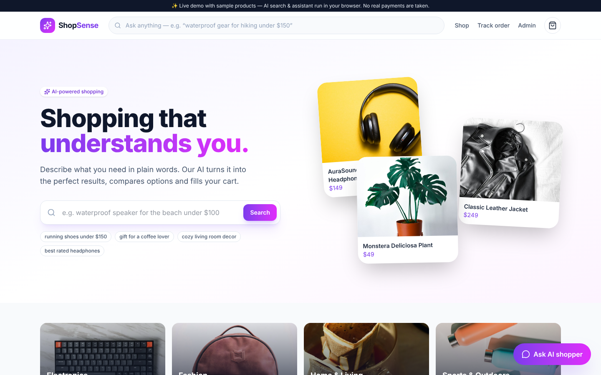
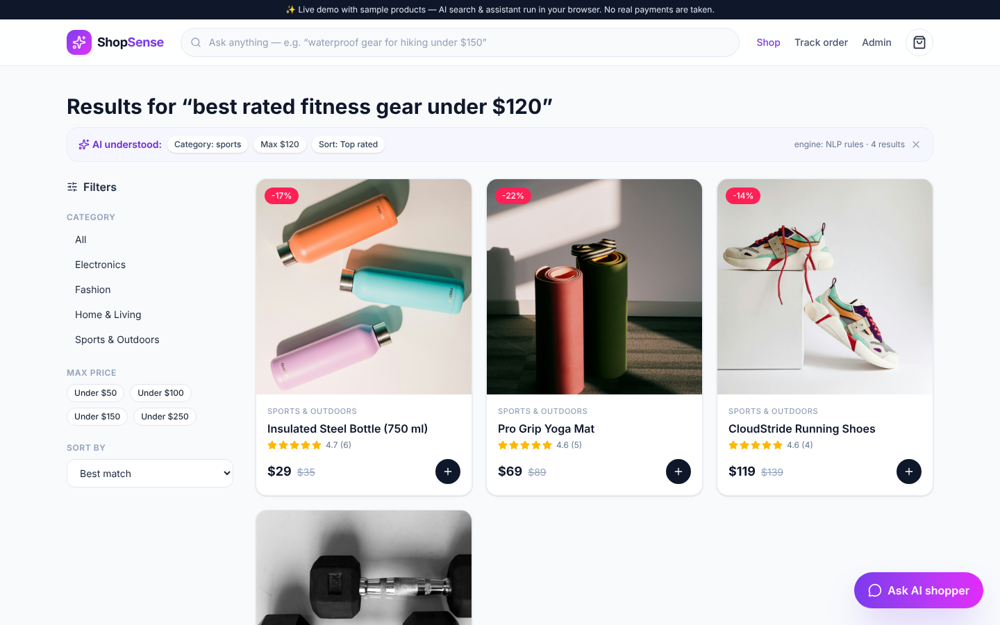
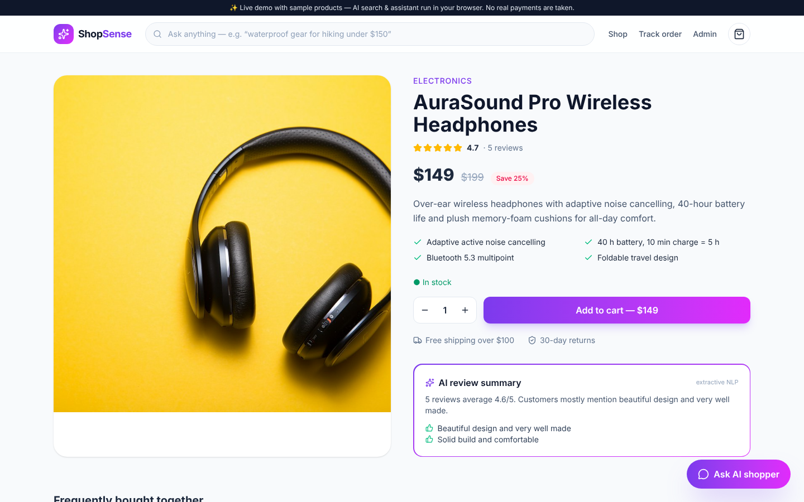
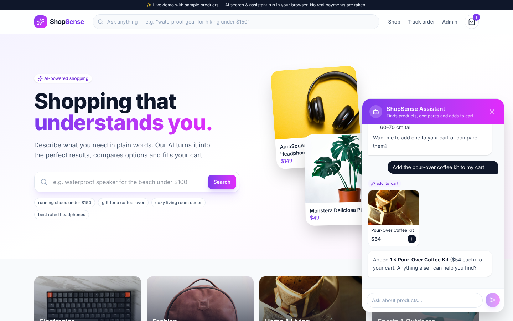
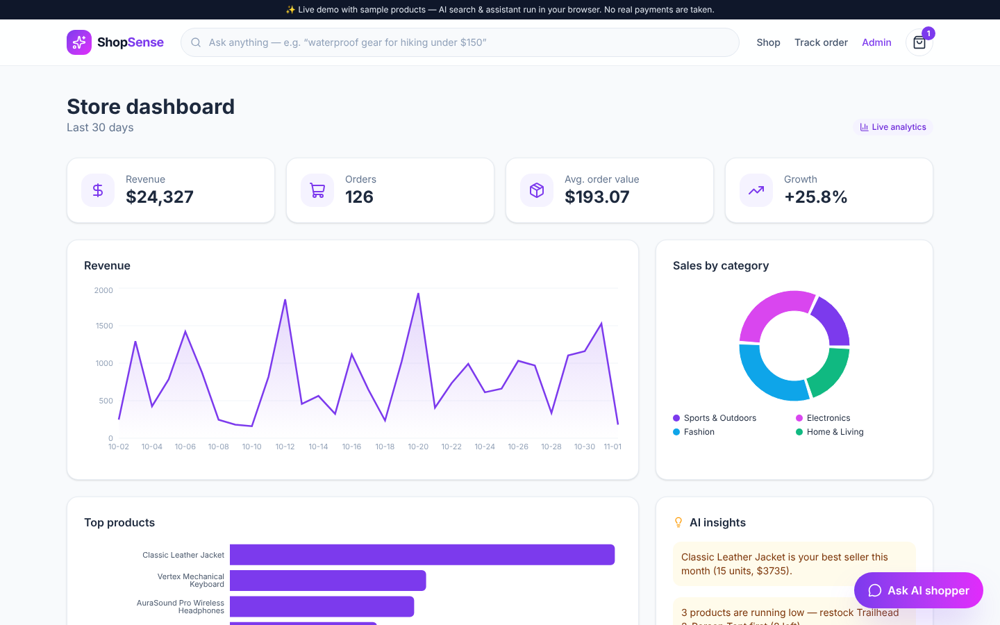
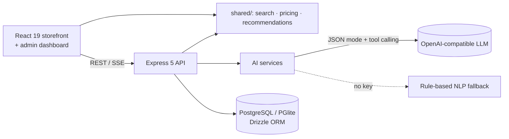

<div align="center">

# 🛍️ ShopSense AI — AI-Powered E-Commerce Platform

### Shopping that understands you

A full-stack online store with **natural-language AI search**, a **tool-calling shopping assistant** that can add items to the cart, **AI review summaries**, **hybrid recommendations** and an **admin dashboard** with an AI copywriter. It runs with or without an LLM key thanks to deterministic NLP fallbacks.

[](https://hanzalasqb.github.io/shopsense-ai/)




</div>

---

## ✨ Features

### For shoppers
- 🔎 **AI search**: *"waterproof gear for hiking under $150"* is turned into structured filters (category, price range, sort, keywords) by an LLM in JSON mode, validated with Zod and backed by a rule-based parser, then ranked with weighted **TF-IDF**
- 🤖 **AI shopping assistant**: a streaming chat agent with tools (`search_products`, `get_product`, `add_to_cart`, `track_order`). It shows product cards and **adds items to your cart** when asked
- ⭐ **AI review summaries**: pros, cons and sentiment for each product, cached in Postgres
- 🎯 **Recommendations**: content-based similarity plus *frequently bought together* from real order baskets, with personalised "Picked for you" based on browsing history
- 🛒 Cart drawer with a free-shipping progress bar, discount codes, **server-side pricing**, checkout and order tracking

### For store owners
- 📊 **Analytics dashboard**: revenue trend, sales by category, top products, AOV, growth and low-stock alerts
- 💡 **AI insights**: plain-language takeaways generated from the metrics
- ✍️ **AI product copywriter**: product descriptions, bullet points and SEO keywords in your chosen tone

### Engineering
- 🔐 JWT auth with roles (customer/admin) and bcrypt. The admin password comes from the environment or is generated on first boot, never hardcoded
- 🧮 Stock decrements are **atomic** (`UPDATE … WHERE stock >= qty`) inside a transaction, so concurrent orders can't oversell
- 🛡️ Helmet, CORS, rate limiting (stricter on AI endpoints), Zod validation everywhere and prompt-injection-aware prompts
- 🗄️ Drizzle ORM with SQL migrations. **PostgreSQL** in production, embedded **PGlite** (Postgres in WASM) for local dev and tests, so no setup is needed
- ♻️ Search, pricing and recommendation logic lives in a `shared/` TypeScript package used by both the API and the browser

## 📸 Screenshots

| AI search: understands intent | Product page with AI review summary |
|---|---|
|  |  |
| **Shopping assistant adds to cart** | **Admin analytics + AI copywriter** |
|  |  |

## 🏗️ Architecture



## 🛠️ Tech stack

| Layer | Technologies |
|---|---|
| **Frontend** | React 19, TypeScript, Vite, Tailwind CSS v4, React Router, Recharts |
| **Backend** | Node.js 22, Express 5, TypeScript, Zod, jose (JWT), bcryptjs, Helmet, express-rate-limit |
| **Database** | PostgreSQL 16, Drizzle ORM + migrations, PGlite for dev/tests |
| **AI** | OpenAI-compatible chat completions (JSON mode, streaming function calling), TF-IDF ranking, hybrid recommender |
| **Testing** | Vitest + Supertest (API, checkout concurrency rules, assistant tool loop with a scripted LLM) |
| **DevOps** | Docker Compose (Postgres + API + Nginx UI), GitHub Actions CI, GitHub Pages demo |

## 🚀 Getting started

```bash
git clone https://github.com/hanzalasqb/shopsense-ai.git
cd shopsense-ai
```

**Docker:**

```bash
cp server/.env.example server/.env    # set JWT_SECRET, ADMIN_PASSWORD and (optionally) LLM_API_KEY
docker compose up --build             # UI http://localhost:3000 · API http://localhost:4000
```

**Local (no database install needed, uses embedded PGlite):**

```bash
cd server && npm install && cp .env.example .env && npm run dev     # API :4000, seeds the catalog
cd client && npm install && npm run dev                             # UI :5173
```

Without `LLM_API_KEY`, search and the assistant use the built-in NLP engine. Add a key (OpenAI, Groq or a local Ollama at `http://localhost:11434/v1`) to switch to the LLM.

## 🔌 API

| Method | Endpoint | Description |
|---|---|---|
| `GET` | `/api/search?q=` | AI search, returns the interpretation and ranked results |
| `GET` | `/api/products` · `/api/products/:slug` | Catalog, details, similar and frequently bought together |
| `GET` | `/api/products/:slug/review-summary` | AI review summary (cached) |
| `GET` | `/api/recommendations?seen=` | Personalised recommendations |
| `POST` | `/api/assistant/stream` | Shopping agent (SSE: `tool_call`, `products`, `cart_action`, `token`) |
| `POST` | `/api/orders/quote` · `/api/orders` | Server-side pricing and checkout |
| `GET` | `/api/orders/track` | Order tracking by number + email |
| `GET/POST` | `/api/admin/analytics` · `/api/admin/ai/description` | Admin analytics and AI copywriter (admin JWT) |

## 🧪 Tests

```bash
cd server && npm test
```

The tests cover query understanding, TF-IDF ranking, pricing rules, discount codes, overselling prevention, auth/RBAC, analytics, review summaries, the rule-based assistant and the **LLM tool-calling loop** (a scripted fake LLM searches and then adds to cart).

## 📁 Structure

```
shopsense-ai/
├── shared/          # search (NLP + TF-IDF), pricing, recommendations, assistant rules, catalog seed
├── server/          # Express API, Drizzle schema + migrations, AI services, tests
├── client/          # React storefront, admin dashboard, demo mode
└── scripts/         # demo image fetcher used by the Pages workflow
```

## 📄 Notes

ShopSense is a portfolio project. The store, products and reviews are fictional sample data, product photos come from [Unsplash](https://unsplash.com) (Unsplash License), and no real payments are processed.

**Author:** Hanzala Saqib, Full Stack AI Developer · [GitHub](https://github.com/hanzalasqb) · [LinkedIn](https://www.linkedin.com/in/hanzalasqb) · MIT License
